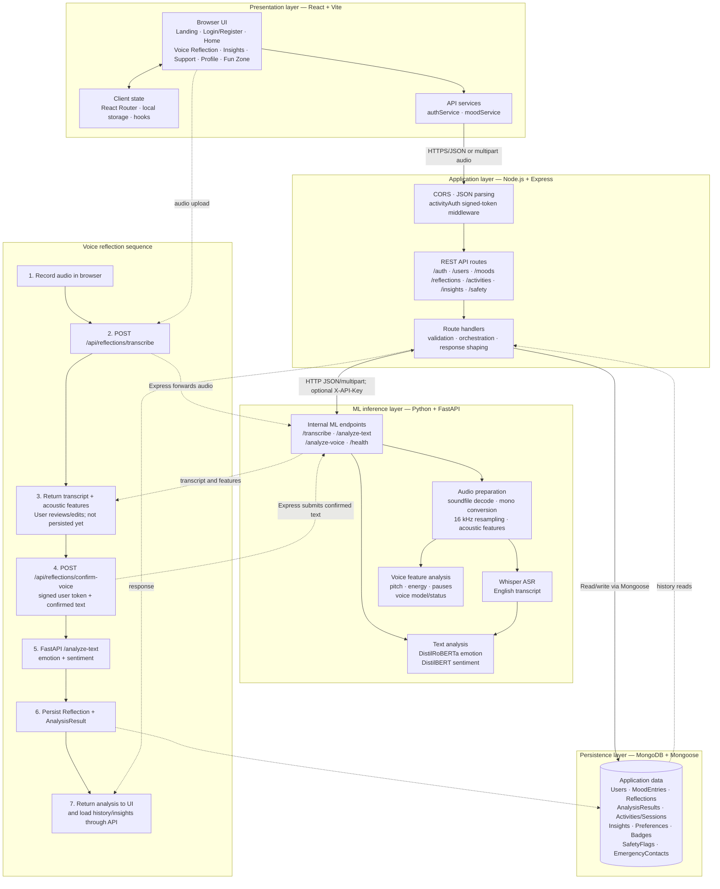

# MindCare — System Architecture

## Main request flows

- **Authentication:** React login/register → Express `/api/auth` → password verification/hash and user record in MongoDB → signed token returned to the client. Protected reflection operations use `activityAuth` to identify the user.
- **Typed reflection:** React → Express `/api/reflections` → FastAPI `/analyze-text` → emotion/sentiment response → `Reflection` and `AnalysisResult` saved in MongoDB → result returned to React.
- **Voice reflection (review flow):** React records audio → Express temporarily receives and forwards it to FastAPI `/transcribe` → Whisper transcript and acoustic features returned for user review. On confirmation, Express sends the confirmed text to `/analyze-text`, saves the reflection and analysis, then returns the combined result. The uploaded temporary file is removed after forwarding.
- **Other wellbeing features:** React calls the relevant Express route for moods, activities, insights, users, or safety; Express reads/writes the corresponding MongoDB models and returns JSON.

## Deployment boundary

The frontend, Express backend, MongoDB database, and ML service are separate components. The backend connects to the ML service using `ML_SERVICE_URL`; when configured, `ML_SERVICE_API_KEY` is sent as `X-API-Key`. The ML service can run locally or on a separate host. MongoDB connects through `MONGO_URI`.
